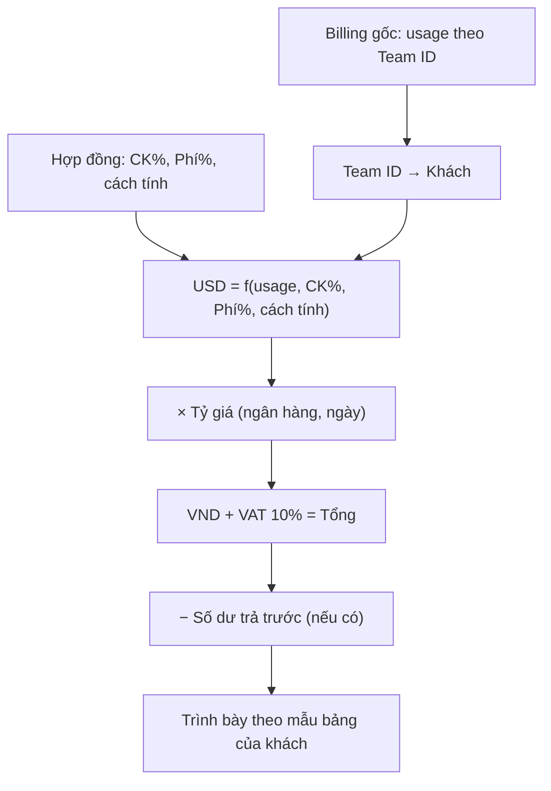
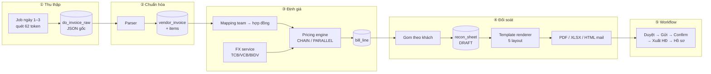
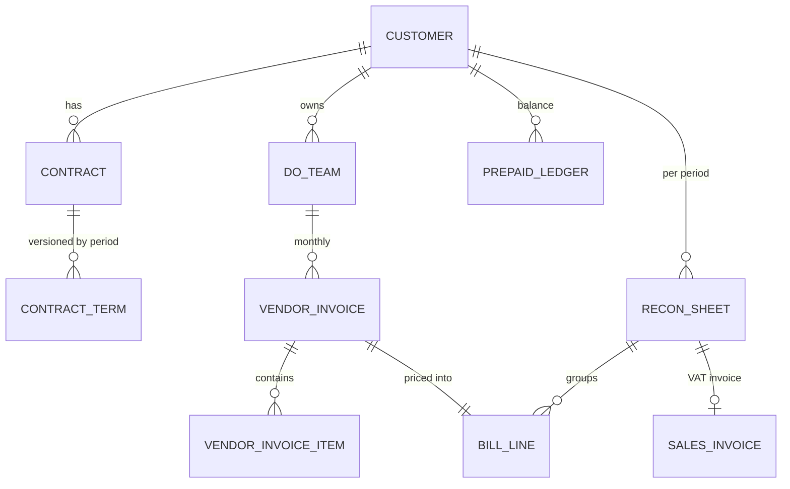
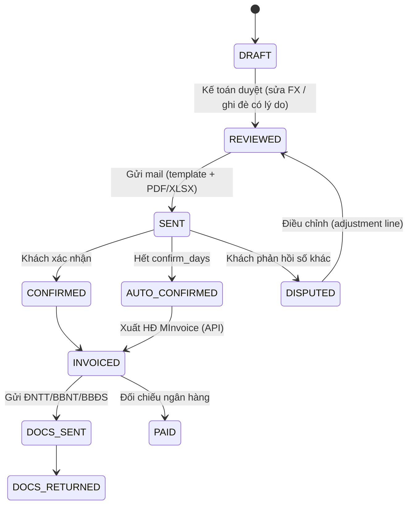

# Giải pháp tự động hóa Billing & Đối soát DigitalOcean — TO-BE

> **Tài liệu thiết kế.** Hiện trạng thủ công: [QuyTrinh_Billing_DoiSoat_DO.md](QuyTrinh_Billing_DoiSoat_DO.md).
>
> **Mục tiêu:** kế toán chỉ còn **duyệt & bấm gửi** — mọi bước gõ tay, copy block, tính công
> thức do hệ thống làm.
>
> **Cấu trúc tài liệu:**
>
> | Mục | Nội dung |
> |---|---|
> | 1 | Kỳ vọng của nghiệp vụ và mức tự động hóa từng bước |
> | 2–5 | Nền tảng kỹ thuật: mô hình truy cập DO (**62 team, 62 token**), các cách lấy hóa đơn, vị trí trong kiến trúc ERP |
> | 6–8 | Dữ liệu: mô hình thực thể, hàm ý thiết kế, **checklist thông tin phải xin từ kế toán/hợp đồng** |
> | 9–12 | Thiết kế hệ thống: pipeline 5 tầng, bảng cấu hình, pricing engine, màn hình kế toán |
> | 13–15 | Lộ trình triển khai và rủi ro |
>
> **Đã kiểm chứng:** mô hình truy cập API (2026-10-12, tài khoản `do.billing@cloudaz.io`);
> PoC `TestDigitalOcean/invoiceReport.js` đã đọc được invoice + summary + items qua API thật.
> **Trạng thái:** chờ chốt nghiệp vụ các câu hỏi Q1–Q8 ([QuyTrinh_Billing_DoiSoat_DO.md](QuyTrinh_Billing_DoiSoat_DO.md) mục 13, 20).

---

## 1. Mục tiêu & cơ hội tự động hóa (TO-BE)

### 1.1. Kỳ vọng trực tiếp của nghiệp vụ

> *"Mong muốn của anh là toàn bộ cái phần này chuyển hết lên ERP, anh chẳng phải làm gì."*
> *"Ví dụ như ngày đầu tháng, mùng 1 mùng 2 gì đấy, thì trên ERP sẽ có một module ghi là **Tính bill**, anh chỉ cần click vào một cái là nó tự động tính tất cả khách. Anh chỉ phải **check lại** thôi — xem tháng nào bất thường gì đấy thì check lại."*

**Hai phương án lấy dữ liệu do chính nghiệp vụ nêu:**

| Phương án | Mô tả | Đánh giá |
|---|---|---|
| **PA1 — Liên kết trực tiếp API DO** | ERP gọi API DO lấy dữ liệu invoice | ⭐ **Khuyến nghị**. DO có API chính thức đầy đủ (xem mục 3). Chính xác 100%, không lệ thuộc OCR |
| **PA2 — Upload PDF, dùng AI đọc invoice** | Upload file PDF → AI bóc tách trường → điền bảng | Dự phòng cho khách/kỳ không lấy được qua API. Cần **đối chiếu tự động** để đảm bảo độ chính xác |

> *"Bởi vì cái AI mà anh đang có nó không thông minh đến mức là up lên nó tự động lọc dữ liệu điền vào đây cho anh được."* ➜ Kỳ vọng của nghiệp vụ với AI đọc PDF là **khả thi về mặt kỹ thuật hiện nay**, nhưng **PA1 vẫn ưu tiên** vì DO đã có API.

### 1.2. Đánh giá khả năng tự động hóa từng bước

| Bước | Tự động hóa | Ghi chú |
|---|---|---|
| B1. Thu thập invoice | ✅ **100%** | API `GET /v2/customers/my/invoices` |
| B2. Bóc tách trường invoice | ✅ **100%** | API CSV + PDF; PA2 (AI) làm dự phòng |
| B3. Check chéo 3 chỉ tiêu (BR-07) | ✅ **100%** | So sánh tự động với kỳ trước + master data |
| B4. Kiểm tra discount ≥ 25% (BR-06) | ✅ **100%** | Cảnh báo tự động |
| B5. Lấy chi tiết mã credit | ✅ **100%** | API — thay thế hoàn toàn thao tác "kéo tay" |
| B6. **Xác định credit của ai** | ⚠️ **Bán tự động** | Cần **workflow phê duyệt**; tự gợi ý theo kết quả kỳ trước cho cùng mã/khách |
| B7. Áp công thức hợp đồng | ✅ **100%** | Rule engine chỉ tiêu cấu hình được (BR-08 → BR-11) |
| B8. Lấy tỷ giá | ✅ **100%** | Theo 3 tham số hợp đồng (BR-12) |
| B9. Tính VAT | ✅ **100%** | Tham số theo hiệu lực thời gian (BR-13) |
| B10. Cảnh báo bất thường | ✅ **100%** | So sánh kỳ trước (BR-15) |
| B11. Sinh bảng đối soát | ✅ **100%** | Template engine 3+ mẫu (BR-16) |
| B12. Sinh mail + screenshot + PDF | ✅ **~90%** | Screenshot → render ảnh từ bảng; cấu hình gộp/tách mail (BR-20) |
| B13. Theo dõi confirm & auto-timeout | ✅ **100%** | BR-21 |
| B14. Xuất hóa đơn VAT | ⚠️ **Tùy tích hợp MInvoice** | Cần khảo sát API MInvoice |
| B15. Sinh hồ sơ thanh toán bản cứng | ✅ **~80%** | Sinh file theo bộ chứng từ cấu hình; ký tươi/đóng dấu vẫn thủ công |
| B16. Bàn giao công nợ | ✅ **100%** | Tái sử dụng module `thu-hoi-cong-no` |

### 1.3. Kiến trúc dữ liệu đề xuất

Chi tiết endpoint ở mục 3:

```
[Cron hàng tháng]
      │
      ▼
[DO Collector]  ── Personal Access Token (read-only)
      │  GET /v2/customers/my/invoices
      │  GET /v2/customers/my/invoices/{uuid}/csv   → chi tiết dòng cước
      │  GET /v2/customers/my/invoices/{uuid}/pdf   → lưu trữ chứng từ
      ▼
[Staging: raw invoice + raw cost lines]
      │
      ▼
[Validator]  ── BR-06 discount, BR-07 định danh, BR-15 anomaly
      │            └─► Hàng đợi "cần người xử lý"
      ▼
[Credit Workflow]  ── gợi ý theo kỳ trước → Cẩm Anh/Sale duyệt
      │
      ▼
[Billing Engine]  ── chỉ tiêu hợp đồng + tỷ giá + VAT
      │
      ▼
[Reconciliation]  ── Template engine → PDF + ảnh + mail
      │
      ▼
[Confirm Tracker] ── timeout = auto-approve (BR-21)
      │
      ▼
[E-Invoice (MInvoice)] ──► [Hồ sơ thanh toán] ──► [Công nợ]
```

---

## 2. Mô hình truy cập: 62 team độc lập, KHÔNG thuộc một organization

> **Kết luận đã kiểm chứng bằng API thật — 2026-10-12.** Đây là ràng buộc nền tảng
> quyết định toàn bộ kiến trúc thu thập dữ liệu.

### Thực trạng

Tài khoản `do.billing@cloudaz.io` (CloudAZ JSC) hiện thấy **62 team** trên
DigitalOcean. **Các team này độc lập, không nằm trong một organization chung
của CloudAZ.** Mỗi team là một tài khoản billing riêng biệt, thuộc org riêng
của từng khách hàng.

Bằng chứng từ trường `user_email` trên hóa đơn — mỗi khách một org id khác nhau:

| Team | `user_email` trên invoice |
|---|---|
| Adflex | `org:1478677671:sa@eway.vn` |
| My Team (digibird) | `org:1668367655809761693:master@digibird.io` |

### Hệ quả: BẮT BUỘC mỗi team một token

DigitalOcean chỉ cho tạo Personal Access Token ở **cấp team**, không có token
cấp organization dùng chung. Một token chỉ đọc được billing của đúng team mà
nó thuộc về.

| Endpoint | Phạm vi | Ghi chú |
|---|---|---|
| `/v2/account` | 1 team | trả `team.uuid` + `team.name` của token |
| `/v2/customers/my/invoices` | **1 team** | `account_urn = do:team:<uuid>` |
| `/v2/teams` | 62 team | **chỉ** `uuid`, `name`, `email`, `user_role` — KHÔNG có billing |
| `/v2/organizations/teams` | — | **403** với mọi token cấp team |

Đã thử 7 cách chuyển ngữ cảnh team trên một token — `?team_uuid=`, `?team_id=`,
header `X-DO-Team`, `X-Team-UUID`, path `/v2/teams/{uuid}/...`,
`/v2/organizations/teams/{uuid}/invoices`. Kết quả:

- 4 cách đầu trả **HTTP 200 nhưng số liệu KHÔNG đổi** — truyền UUID rác
  `00000000-0000-0000-0000-000000000000` vẫn ra đúng invoice của team gốc.
  Tham số bị **bỏ qua**, không phải được chấp nhận.
- 3 cách path trả **404**.

> [!WARNING]
> Cái bẫy khi kiểm thử: HTTP 200 **không** nghĩa là lấy được dữ liệu team khác.
> Phải so sánh `invoice_uuid` trả về với baseline (lần gọi không truyền tham số).
> Giống nhau = tham số bị bỏ qua.

### Vận hành: quản 62 token

- **Scope tối thiểu**: `billing:read` + `account:read`. Không cần quyền tài nguyên
  (`droplet`, `database`…) — token đọc hóa đơn không nên xóa được Droplet của khách.
- **Role cần thiết**: `Owner` hoặc `Biller` trên team đó. `Member` không thấy trang Billing.
- **Token có thể hết hạn**: khách đặt 30/60/90 ngày thì sync chết lặng khi tới hạn.
  Phải ghi log lỗi theo từng team và cảnh báo chủ động.
- **Lưu trữ**: mã hóa trong DB (AES-256-GCM), không để plaintext trong `.env`.
  Khóa master nằm ngoài DB. Mất khóa = mất toàn bộ token.

### Nhận diện khách từ danh sách team

`/v2/teams` nạp được 62 dòng tự động, nhưng **15/62 team trùng tên `"My Team"`**
(tên mặc định DO, khách không đổi). Không phân biệt được bằng `name`.

- Khóa ánh xạ phải là **`uuid`**, không dùng `name`.
- Dùng `email` làm gợi ý khi `name` vô nghĩa:
  `tnguyen.actlife@gmail.com` → actlife, `admin@thaiam.vn` → Thái Am.
- Việc ánh xạ `uuid → khách hàng` làm **thủ công một lần**, lưu vào DB.

### Mô hình dữ liệu tương ứng

```
org (pháp nhân/khách hàng — khái niệm của CloudAZ, KHÔNG phải org của DO)
 └─ team (1 team DO = 1 token = 1 tài khoản billing)
     └─ invoice (khóa tự nhiên: team_id + kỳ cước, 1 dòng/tháng)
         └─ invoice_item (từng dòng cước)
```

Token lưu ở cấp **team**, không phải cấp org — vì mỗi team cần token riêng.

---

## 3. Các cách lấy hóa đơn

### Cách 1 — REST API (khuyên dùng cho ERP Backend)

Dùng **Personal Access Token** read-only, tạo **riêng cho từng team** (scope `billing:read` + `account:read`).

| Mục đích | Endpoint |
|---|---|
| Danh sách hóa đơn (lấy `invoice_uuid` từng tháng) | `GET /v2/customers/my/invoices` |
| Chi tiết dòng cước — `group_description`, `duration`, `start_time`, `end_time`, `project_name`, `resource_uuid` | `GET /v2/customers/my/invoices/{uuid}` |
| Tổng hợp để đối soát — `product_charges`, `overages`, `taxes`, `credits_and_adjustments` | `GET /v2/customers/my/invoices/{uuid}/summary` |
| File CSV chi tiết lượng dùng từng tài nguyên (Droplets, Volumes, Spaces…) | `GET /v2/customers/my/invoices/{uuid}/csv` |
| File PDF để lưu chứng từ và gửi khách | `GET /v2/customers/my/invoices/{uuid}/pdf` |
| Danh mục team phục vụ ánh xạ khách hàng (62 dòng: `uuid`, `name`, `email`, `user_role`) | `GET /v2/teams?per_page=200` |

Base URL: `https://api.digitalocean.com`

> [!WARNING]
> Mọi endpoint `/v2/customers/my/*` **chỉ** trả dữ liệu của đúng team mà token thuộc về.
> Không có tham số nào chuyển được ngữ cảnh sang team khác — `?team_uuid=` trả HTTP 200
> nhưng **bị bỏ qua**, vẫn ra dữ liệu team gốc. Chi tiết kiểm chứng ở mục
> *Mô hình truy cập* bên trên.

Dùng `/v2/customers/my/invoices/{uuid}` + `/summary` thay cho việc parse CSV khi chỉ cần số liệu đối soát — nhẹ hơn và không phải xử lý file.

### Cách 2 — CLI `doctl` (cho script shell)

```bash
doctl invoice list                                  # lấy UUID
doctl invoice csv <INVOICE-UUID> billing_detail.csv # tải CSV
doctl invoice pdf <INVOICE-UUID> invoice.pdf        # tải PDF
```

### Cách 3 — Thủ công trên Console (dự phòng khi token lỗi/hết hạn)

**Quyền yêu cầu:** vai trò **Owner** hoặc **Biller** trên Team Account. Vai trò **Member** không nhìn thấy trang Billing và không tải được hóa đơn.

1. Đăng nhập [DigitalOcean Control Panel](https://cloud.digitalocean.com/).
2. Chọn đúng **Team Account** ở menu chuyển đổi góc trên bên trái (nếu tài khoản thuộc nhiều team).
3. Thanh điều hướng bên trái → **Billing**.
4. Cuộn xuống **Billing History**, chọn hóa đơn của tháng cần đối soát.
5. Nhấn **Download**, chọn định dạng: **PDF** (chứng từ lưu trữ tài chính) hoặc **CSV** (dữ liệu bảng để import).
6. Chụp màn hình bảng phân bổ chi tiết nếu cần làm bằng chứng đối soát.

---

## 4. Kiến trúc thu thập dữ liệu — vì sao DO không cần data warehouse

```
ERP Backend chạy cronjob định kỳ
    → lặp qua TỪNG team (mỗi team một Personal Access Token riêng)
        → gọi DigitalOcean REST API lấy danh sách Invoices của team đó
        → lấy invoice_items + summary, hoặc tải CSV/PDF theo invoice_uuid
        → parse → lưu DB nội bộ (khóa: team + kỳ cước)
```

*Khác với Google và AWS: DO không cần hạ tầng data warehouse trung gian.*

---

### Ưu điểm
- **Đơn giản**: DO cung cấp REST API chính thức, tường minh, tải trực tiếp CSV và PDF theo UUID hóa đơn. Không cần cấu hình S3/BigQuery hay SFTP.
- **Độ tin cậy cao**: dữ liệu hóa đơn từ API là dữ liệu **đã chốt sổ chính thức** cuối tháng — chính xác để đối soát trực tiếp.

### Nhược điểm & thách thức
- **Xử lý file ở backend**: ERP phải tự tải, parse và ghi DB. Nếu khách dùng hàng nghìn Droplets/Volumes, file CSV lớn — **bắt buộc dùng stream parser** để tránh tràn RAM (OOM).
- **Quản 62 token**: không có token dùng chung cho nhiều team (xem mục 2). Phải thu thập, mã hóa, theo dõi hạn và xin lại khi khách rotate token.


---

## 5. Vị trí trong kiến trúc chung

DO là ngoại lệ duy nhất không đi qua tầng data warehouse. Tuy nhiên vẫn phải tuân thủ hai tầng chung của ERP:

- **Tầng ánh xạ**: tài nguyên DO → khách hàng → hợp đồng → pháp nhân
- **Tầng tính cước**: công thức hợp đồng, tỷ giá, thuế, làm tròn — đặt trong ERP, không đặt trong code parse

Xem `docs/modules/fin/DOMAIN.md`.
## 6. Mô hình dữ liệu đề xuất (sơ bộ)

| Thực thể | Trường chính | Ghi chú riêng cho DO |
|---|---|---|
| `Provider` | code (DO/AWS/GWS/GCP/GMP), tên | |
| `DoOrganization` | mã org, loại (**CLOUDAZ_SHARED** / **CUSTOMER_OWN**), phương thức truy cập, token | Nhánh A / Nhánh B ở mục 3.2 |
| `DoTeam` | **team_id (PK nghiệp vụ)**, org_id, display_name, email, customer_id, trạng thái (ACTIVE / **DELETED**) | ⚠️ **Không dùng display_name làm khóa** (BR-04). Ghi nhận lịch sử đổi tên |
| `Customer` | mã KH, tên, template đối soát mặc định, chính sách gộp/tách mail, bộ chứng từ yêu cầu, hạn confirm, `payment_term_trigger` | Nơi tập trung mọi "tùy chọn theo khách" |
| `Contract` | customer_id, danh sách team_id, **chiết khấu %**, **phí dịch vụ %**, phụ thu, **ngân hàng tỷ giá**, **loại tỷ giá**, **thời điểm chốt tỷ giá**, hạn confirm, mốc tính hạn thanh toán | Nguồn của mọi công thức (BR-08→BR-12, BR-24) |
| `ContractCharge` | contract_id, tên chỉ tiêu, **kiểu = PERCENT \| AMOUNT**, giá trị, thứ tự áp dụng, hiệu lực từ | **Configurable** — đáp ứng BR-09, BR-10, BR-11 |
| `BillingPeriod` | kỳ (YYYY-MM), trạng thái (MỞ / ĐANG TÍNH / CHỜ CONFIRM / ĐÃ XUẤT HĐ / ĐÓNG) | |
| `DoInvoice` | period, team_id, **invoice_number**, issue_date, **total_due (USD)**, **total_usage (USD)**, discount, provider_tax, file PDF, file CSV | Lưu **archive vĩnh viễn** để chống BR-05 |
| `CostLine` | invoice_id, service, resource, amount | Nạp từ CSV — hiện nghiệp vụ *bỏ qua*, nhưng nên lưu để giải trình khi khách hỏi |
| `CreditItem` | period, team_id, **credit_code**, số tiền, **chủ sở hữu (CLOUDAZ / KHÁCH)**, người xác nhận (Cẩm Anh/Sale), thời điểm xác nhận | Cốt lõi workflow P1–P2; **tái sử dụng kết quả kỳ trước** |
| `ExchangeRate` | ngày, ngân hàng, loại tỷ giá, giá trị | Tự thu thập theo tham số hợp đồng |
| `TaxRate` | loại (VAT_VN / PROVIDER_TAX), tỷ lệ, hiệu lực từ | BR-13 — **không hardcode 10%** |
| `BillLine` | period, customer_id, team_id, các cột 6→19 ở mục 5.1 | Thay thế Google Sheet |
| `ReconciliationSheet` | period, customer_id, template_id, số liệu, file PDF, ảnh screenshot | |
| `Template` | tên, loại (**DỌC / NGANG / GIỐNG CONSOLE**), nội dung | **CRUD được**, không giới hạn 3 loại (BR-16) |
| `DocumentRequirement` | customer_id, loại chứng từ (nghiệm thu / đối soát / đề nghị TT), bắt buộc?, mẫu | **Số hóa P7** |
| `MailLog` | period, customer_id, người nhận, nội dung, đính kèm, thời điểm gửi, thời điểm confirm | Phục vụ BR-21 |
| `AnomalyAlert` | period, team_id, loại (CREDIT_MỚI / USAGE_ĐỘT_BIẾN / DISCOUNT_THẤP), giá trị kỳ này, kỳ trước, trạng thái xử lý | BR-15 |

---

## 7. Hàm ý cho thiết kế ERP

| Thành phần | Yêu cầu rút ra |
|---|---|
| `Contract` | Thêm `calc_method (CHAIN \| PARALLEL)`, `discount_pct`, `fee_pct` (cho phép số lẻ), `fx_bank`, `fx_rule (END_OF_MONTH \| INVOICE_DATE)`, `confirm_days`, `seller_entity (CLOUDAZ \| CLOUDINO)` |
| `Customer` | `recon_layout` (5 mẫu ở [QuyTrinh_Billing_DoiSoat_DO.md](QuyTrinh_Billing_DoiSoat_DO.md) mục 17.3), `doc_bundle` (ĐNTT/ĐSCP/BBNT/BBĐS/ký số), `invoice_email`, `recon_emails`, `payment_term_text`, `uom_label` |
| `BillLine` | 1 dòng / team / kỳ; cột Z (số HĐ) cho phép nhiều team chung 1 HĐ |
| Trạng thái | Thay các cột tick AA–AF bằng workflow: `DRAFT → SENT → CONFIRMED / AUTO_CONFIRMED → INVOICED → DOCS_SENT → DOCS_RETURNED` |
| Lịch sử | Thay "block xếp chồng" bằng bảng `ReconciliationSheet` theo kỳ — tra lịch sử theo khách trực tiếp |
| Kiểm tra | Tự kiểm cột K (discount ≈ 25%), so Q giữa 2 file, so tổng VND giữa bảng Bill và bảng đối soát |
| Trả trước | Sổ số dư `PrepaidBalance` cấn trừ theo kỳ |
## 8. Thông tin cần bổ sung để ra được bảng đối soát

> Danh sách đầy đủ các dữ liệu mà ERP phải được cấp mới tính ra số tiền và trình bày
> đúng mẫu. Dùng làm checklist khi đi lấy cấu hình từ kế toán và hợp đồng.

### 8.1. Bắt buộc — thiếu thì không tính ra số tiền

| # | Thông tin | Dùng để | Nguồn |
|---|---|---|---|
| 1 | **Team ID thuộc khách nào** | Xác định bảng của ai, gom nhiều team của cùng một khách | Danh mục khách hàng (file Bill cột B, F) |
| 2 | **Chiết khấu khách %** | Dòng "Chiết khấu" (10% / 11% / 12%) | Hợp đồng (cột R) |
| 3 | **Phí dịch vụ %** | Dòng "Phí dịch vụ" (10% / 5,88% / 5,26%) | Hợp đồng (cột S) |
| 4 | **Cách tính: nhân chuỗi hay song song** | Cùng 10%/10% nhưng kết quả lệch nhau 1% | Hợp đồng — **chưa ghi ở đâu, phải hỏi kế toán (Q1)** |
| 5 | **Tỷ giá** | Quy đổi USD sang VND | Ngân hàng TCB / VCB / BIDV, cuối tháng hoặc ngày xuất HĐ |
| 6 | **Thuế GTGT %** | Tính VAT (hiện là 10%) | Quy định thuế |
| 7 | **Quy tắc làm tròn** | Để số trên bảng khớp với hóa đơn | **Chưa thống nhất, cần chốt (Q7)** |

Hai cách tính USD (mục 4):

| Cách | Công thức |
|---|---|
| Nhân chuỗi (`CHAIN`) | `USD = usage × (1 + Phí%) × (1 − CK%)` |
| Song song (`PARALLEL`) | `USD = usage × (1 − CK%) + usage × Phí%` |

### 8.2. Cần để trình bày đúng mẫu

| # | Thông tin | Ví dụ |
|---|---|---|
| 8 | Tên khách hiển thị trên tiêu đề | `ĐỐI SOÁT CHI PHÍ DIGITALOCEAN - ADFLEX` |
| 9 | **Mẫu bảng** của khách | 1 trong 5 mẫu: `VERTICAL_CHAIN`, `VERTICAL_PARALLEL`, `HORIZONTAL_ROWS`, `HORIZONTAL_COLS`, `SERVICE_BREAKDOWN` |
| 10 | Thứ tự dòng hoặc nhãn riêng | AGAPISC / HAMSA ghi phí trước, chiết khấu sau |
| 11 | Phụ phí ngoài (cột T) | Hiện luôn bằng 0 |

### 8.3. Tình huống đặc biệt của từng khách

| # | Thông tin | Khách |
|---|---|---|
| 12 | **Số dư trả trước** (kỳ trước) | ACTLIFE |
| 13 | Tiền cọc | SZEN7 |
| 14 | Có trừ credit của khách hay không | FRESHDI, VIENOSE — **chưa rõ (Q2)** |
| 15 | Số tiền khách xác nhận khác số tính ra (nếu có) | "hoặc đúng số tiền khách xác nhận" |

### 8.4. Cần để gửi đi (không ảnh hưởng số tiền)

| # | Thông tin |
|---|---|
| 16 | Email nhận đối soát (To / CC) và email nhận hóa đơn riêng |
| 17 | Pháp nhân bán: CloudAZ hay Cloudino |
| 18 | Số hợp đồng |
| 19 | Số ngày chờ khách confirm (2 hoặc 3 ngày) |
| 20 | Hạn thanh toán |
| 21 | Bộ hồ sơ cần gửi kèm: ĐNTT, ĐSCP, BBNT, BBĐS, ký số |
| 22 | Có gửi kèm ảnh chụp billing hoặc ảnh tỷ giá không |

---

### 8.5. Luồng tính



### 8.6. Tình trạng nguồn dữ liệu

| Thông tin | Đã có ở đâu | Tần suất cập nhật |
|---|---|---|
| Mục 1, 2, 3 | Có sẵn trong Excel (cột R, S và ghi chú AG–AL) | Nhập 1 lần, sửa khi đổi hợp đồng |
| Mục 4 | **Chưa có — hỏi kế toán (Q1)** | 1 lần |
| Mục 5 (tỷ giá) | Cột V file Bill, gõ tay | **Mỗi kỳ** — thông tin duy nhất phải cập nhật lại |
| Mục 7 | **Chưa có — chốt với kế toán (Q7)** | 1 lần |
| Mục 8–22 | Có sẵn trong Excel (file Đối soát, ghi chú AG–AL) | Nhập 1 lần |
## 9. Tổng quan kiến trúc



| Tầng | Thay thế thao tác AS-IS | Mức tự động |
|---|---|---|
| ① Thu thập | Tải PDF, mở mail | 100% |
| ② Chuẩn hóa | Gõ tay số invoice, usage, discount, total due | 100% |
| ③ Định giá | Nhân bản sheet, gõ R/S/tỷ giá, kéo công thức | 100% (tỷ giá: tự lấy + cho sửa) |
| ④ Đối soát | Copy block tháng trước, sửa số | 100% |
| ⑤ Workflow | Tick `x` cột AA–AF, nhớ hạn confirm | Bán tự động (người duyệt & gửi) |

---

## 10. Dữ liệu cấu hình (số hóa "master data trá hình" cột R, S, AG–AL)



### 10.1. `contract_term` — có hiệu lực theo kỳ (giải quyết ADFLEX đổi phí 5.26% → 10%)

| Trường | Kiểu | Ví dụ |
|---|---|---|
| `effective_from` / `effective_to` | date | 2026-01-01 / null |
| `calc_method` | `CHAIN` \| `PARALLEL` | ADFLEX: CHAIN; FINSIFY: PARALLEL |
| `discount_pct` | decimal(7,4) | 0.12 |
| `fee_pct` | decimal(7,4) — cho phép 0.0588 | 0.10 |
| `extra_fee_usd` | decimal | 0 |
| `fx_bank` | `TCB` \| `VCB` \| `BIDV` | TCB |
| `fx_rule` | `END_OF_MONTH` \| `INVOICE_DATE` | END_OF_MONTH |
| `seller_entity` | `CLOUDAZ` \| `CLOUDINO` | CLOUDINO |

### 10.2. `customer_recon_profile`

| Trường | Ví dụ |
|---|---|
| `layout` | `VERTICAL_CHAIN` · `VERTICAL_PARALLEL` · `HORIZONTAL_ROWS` · `HORIZONTAL_COLS` · `SERVICE_BREAKDOWN` |
| `addons` | `[PREPAID_BALANCE]` |
| `recon_emails` / `invoice_email` | danh sách To/CC; mail HĐ riêng (VIMARKET) |
| `confirm_days` | 2 / 3 |
| `send_window` | ngày 1–2 / 5–7 đầu tháng |
| `doc_bundle` | `[DNTT, DSCP, BBNT, BBDS, DIGITAL_SIGN]` |
| `payment_term_text`, `uom_label` | "7 ngày từ khi nhận hồ sơ", "Gói" |
| `attach_billing_screenshot`, `attach_fx_proof` | bool |
| `group_invoice` | true → nhiều team 1 HĐ VAT |

> [!TIP]
> **Migration 1 lần:** parse sheet `07.2026` (cột A, B, C, F, R, S, AG–AL) + nhận diện mẫu từ file Đối soát
> (script phân loại 5 mẫu đã chạy được) → sinh sẵn ~62 `do_team`, ~56 `customer_recon_profile`, `contract_term`.
> Kế toán chỉ rà lại các khách thuộc câu hỏi Q1, Q3.

---

## 11. Pipeline chi tiết

### ① Thu thập — `do-invoice-collector` (cron ngày 1, retry đến ngày 3)

```
for team in do_team where active:
    token = vault.get(team.token_ref)
    list  = GET /v2/customers/my/invoices            → lấy invoice kỳ trước (invoice_period = YYYY-MM)
    inv   = GET /v2/customers/my/invoices/{uuid}     → items (phân trang)
    sum   = GET /v2/customers/my/invoices/{uuid}/summary
    pdf   = GET /v2/customers/my/invoices/{uuid}/pdf → lưu làm chứng từ gốc
    upsert do_invoice_raw(team_id, period, uuid, json, pdf_path, fetched_at)
```
- **Idempotent** theo `(team_id, period)`; chạy lại không nhân đôi.
- Team không có invoice → ghi trạng thái `NO_USAGE` (thay cho dòng trống SMIT, VBC…).
- Token lỗi/hết hạn → cảnh báo, cho phép **upload PDF thủ công** làm đường dự phòng.

### ② Chuẩn hóa — `vendor_invoice`

| Trường ERP | Lấy từ API summary | Cột Excel cũ |
|---|---|---|
| `invoice_number` | `invoice_number` | E |
| `usage_usd` | `product_charges.amount` (Total usage) | P / Q |
| `vendor_discount_usd` | `credits_and_adjustments` (partner discount) | M |
| `total_due_usd` | `amount` | L / I |
| `customer_credit_usd` | adjustments loại credit | O |
| items | `group_description`, `product`, `amount` | (mẫu SERVICE_BREAKDOWN) |

### ③ Định giá — `pricing-engine` (thuần hàm, có unit test)

```ts
function priceUsd(q: Decimal, t: ContractTerm): PriceResult {
  if (t.calc_method === 'CHAIN') {
    const gross    = round2(q.mul(1 + t.fee_pct));          // Giá trước CK (gồm phí)
    const discount = round2(gross.mul(t.discount_pct));
    return { gross, discount, fee: gross.sub(q), amountUsd: gross.sub(discount) };
  }
  // PARALLEL
  const discount = round2(q.mul(t.discount_pct));
  const fee      = round2(q.mul(t.fee_pct));
  return { discount, fee, amountUsd: q.sub(discount).add(fee) };
}
```

- **Làm tròn chuẩn (chốt Q7):** USD 2 số lẻ theo từng bước hiển thị trên bảng (để bảng tự cộng khớp),
  VND `ROUND(…,0)`, VAT tính trên tổng VND đã làm tròn của **cả bảng**.
- **Tỷ giá:** `fx-service` lấy tỷ giá bán chuyển khoản cuối tháng của ngân hàng theo `fx_bank`, lưu bảng `fx_rate(bank, date, rate, source_url)`.
  Kế toán có thể **ghi đè** (lưu người sửa + lý do). Khách `INVOICE_DATE` → tính lại khi xuất HĐ.
- **Kiểm tra tự động (flag, không chặn):**
  - `vendor_discount / usage` ∉ [24%, 26%]
  - usage lệch > ±50% so với tháng trước
  - `customer_credit > 0` (case FRESHDI — chờ trả lời Q2)
  - team có invoice nhưng chưa map khách / hợp đồng hết hiệu lực

`bill_line` lưu thêm **giá vốn & lãi gộp** (`total_due_usd`, `amountUsd − total_due_usd`) — thay luôn file Tính Bill.

### ④ Sinh bảng đối soát

```
for customer in customers_with_bill_lines(period):
    sheet = recon_sheet(customer, period, status=DRAFT, layout=profile.layout)
    sheet.lines   = bill_lines của các team thuộc customer
    sheet.vnd     = Σ round0(line.amountUsd × fx)
    sheet.vat     = round0(sheet.vnd × 10%)
    sheet.total   = sheet.vnd + sheet.vat
    if PREPAID_BALANCE: sheet.prepaid_used / remaining từ prepaid_ledger
    snapshot toàn bộ tham số (term, fx) vào sheet → bất biến sau khi gửi
```

**Template renderer:** 1 view-model chung → 5 template (Handlebars/EJS cho HTML mail & PDF, ExcelJS cho XLSX).
Layout chỉ quyết định **cách trình bày**, số liệu lấy từ cùng một kết quả pricing — tránh lệch như hiện tại.

| Layout | Nguồn dòng hiển thị |
|---|---|
| `VERTICAL_CHAIN` | Billing → gross → discount → amount → FX → VND → VAT → total |
| `VERTICAL_PARALLEL` | Billing → discount → fee → amount → … |
| `HORIZONTAL_ROWS` | 1 dòng / team, cột Discount, Tax‑Fee |
| `HORIZONTAL_COLS` | 1 cột / team + cột Tổng |
| `SERVICE_BREAKDOWN` | items group theo `group_description` (tái dụng `invoiceReport.js`) + khối CHAIN |

### ⑤ Workflow & trạng thái



- **Mail:** gửi từ hộp thư kế toán (Gmail/Outlook API), lưu `thread_id` → reply của khách gắn vào sheet.
  DIGIBANK: cờ `new_thread_each_period`.
- **Scheduler:** nhắc khi tới `send_window`, tự chuyển `AUTO_CONFIRMED` sau `confirm_days` (ngày làm việc).
- **Xuất HĐ:** gọi API MInvoice theo `seller_entity`; `group_invoice` → 1 HĐ cho nhiều team; ghi `sales_invoice_no` ngược lại sheet (thay cột Z).
- **Hồ sơ:** sinh ĐNTT/BBNT/BBĐS từ template theo `doc_bundle`, cùng số liệu với sheet.

---

## 12. Màn hình chính cho kế toán

| Màn hình | Nội dung |
|---|---|
| **Kỳ billing** (dashboard) | 62 team: trạng thái thu thập, cảnh báo, tổng usage / doanh thu / lãi gộp |
| **Danh sách đối soát** | 1 dòng / khách, thay cột AA–AF: trạng thái, hạn confirm, nút *Duyệt & gửi hàng loạt* |
| **Chi tiết đối soát** | Preview đúng layout khách, so sánh tháng trước, lịch sử mail, ghi đè FX/số tiền |
| **Cấu hình khách / hợp đồng** | Profile + contract_term có lịch sử hiệu lực |
| **Tra lịch sử** | Mọi kỳ của 1 khách (thay block xếp chồng trong sheet) |

---

## 13. Lộ trình triển khai

| Giai đoạn | Phạm vi | Kết quả kiểm chứng |
|---|---|---|
| **P0 – Chốt nghiệp vụ** (1 tuần) | Trả lời Q1–Q8, chốt quy tắc làm tròn | Biên bản xác nhận với kế toán |
| **P1 – Dữ liệu** (2 tuần) | Collector + parser + migration master data từ Excel | 62 team kỳ 07.2026 khớp cột E, L, M, P |
| **P2 – Pricing + Recon** (2 tuần) | Engine, FX, 5 template, export XLSX/PDF | **Chạy song song** kỳ 08–09/2026: lệch so với Excel = 0 (hoặc ≤ 1đ có giải thích) |
| **P3 – Workflow** (2 tuần) | Mail, auto-confirm, trạng thái, prepaid ledger | Kế toán gửi thật 1 kỳ qua ERP |
| **P4 – Tích hợp** | MInvoice API, hồ sơ ĐNTT/BBNT, đối chiếu thu tiền | Bỏ file Excel |

> [!IMPORTANT]
> **Golden test:** dùng số liệu kỳ 07.2026 trong 2 file Excel làm bộ test hồi quy — mỗi khách phải ra đúng
> USD, VND, VAT, tổng như block đối soát đã gửi (ADFLEX 63.981.259; ONADS 69.451.338; SECOMUS 76.013.803; …).

### 13.1. Thứ tự ưu tiên theo điểm nghẽn (bản phân tích 2026-08-28)

Cách chia giai đoạn theo **điểm nghẽn được xóa** — đọc kèm bảng P0–P4 ở trên, không thay thế nó.
Mã `P1`–`P7` trong cột *Lý do ưu tiên* là pain point ở [QuyTrinh_Billing_DoiSoat_DO.md](QuyTrinh_Billing_DoiSoat_DO.md) mục 11.

| Giai đoạn | Nội dung | Lý do ưu tiên |
|---|---|---|
| **GĐ 1** | Master data (`DoOrganization`, `DoTeam`, `Customer`, `Contract`, `ContractCharge`) + **Collector API DO** nạp invoice tự động | Nền tảng. DO có API sạch — làm được ngay, ít rủi ro |
| **GĐ 2** | **Billing Engine**: rule engine chỉ tiêu + tỷ giá tự động + VAT + validator (BR-06, BR-07) | Xóa **P3, P4** — khối lượng nhập tay lớn nhất |
| **GĐ 3** | **Credit Workflow**: tự bóc mã credit từ API + gợi ý theo kỳ trước + phê duyệt nội bộ | Xóa **P1, P2** — điểm nghẽn số 1 của DO |
| **GĐ 4** | **Anomaly Alert** (BR-15) — cảnh báo credit mới / lượng dùng đột biến / discount thấp | Hiện thực đúng kỳ vọng *"anh chỉ phải check lại thôi"* |
| **GĐ 5** | **Template engine** bảng đối soát (5 mẫu, CRUD được) + sinh PDF + screenshot | Xóa **P5, P6** |
| **GĐ 6** | **Mail engine**: gộp/tách theo cấu hình khách (BR-20) + tracking confirm + auto-timeout (BR-21) | Khép kín vòng đối soát |
| **GĐ 7** | **Bộ chứng từ theo khách** (`DocumentRequirement`) + sinh hồ sơ thanh toán | Xóa **P7** — rủi ro tri thức cá nhân |
| **GĐ 8** | Tích hợp **MInvoice** + bàn giao công nợ (tái sử dụng module đã có) | Khép kín vòng đời |

> **Đề xuất:** dùng **DO làm PILOT** cho toàn bộ kiến trúc Billing của ERP_Cloudaz. Lý do: quy trình đơn giản nhất, dữ liệu sạch nhất (invoice khớp console 100%), API chính thức đầy đủ. Kiến trúc chạy được với DO sẽ mở rộng sang AWS/GCP/GWS/GMP với chi phí thấp hơn nhiều so với làm ngược lại.

---

## 14. Rủi ro & cách xử lý

| Rủi ro | Xử lý |
|---|---|
| 62 token hết hạn / bị thu hồi | Vault + health-check hằng tuần; fallback upload PDF |
| Chưa chốt CHAIN/PARALLEL | Migrate theo hiện trạng dòng 3–24 = CHAIN, còn lại PARALLEL; đánh dấu "cần xác nhận" |
| Nguồn tỷ giá ngân hàng không có API | Crawl trang tỷ giá + cho nhập tay, lưu ảnh chụp làm chứng cứ (đáp ứng "gửi ảnh tỷ giá") |
| Khách xác nhận số khác | Trạng thái `DISPUTED` + dòng điều chỉnh có audit, không sửa số gốc |
| Sửa sau khi gửi | Sheet đã `SENT` là bất biến; sửa = tạo version mới |
